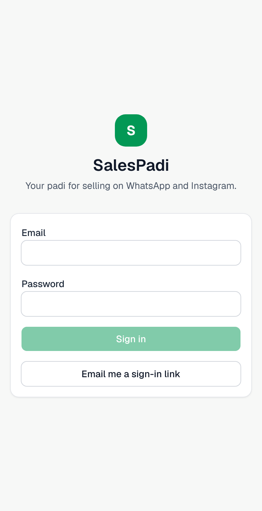

# SalesPadi

A done-for-you AI sales assistant for Nigerian Instagram and WhatsApp vendors. Customers chat on WhatsApp or Instagram and get instant answers with photos and prices; the assistant takes the order, sends a Paystack link or bank details, confirms payment and keeps the customer updated through delivery. You run it for many vendors from one dashboard.



## What's in the box

| Area | What it does |
| --- | --- |
| **Channels** | WhatsApp Cloud API and Instagram DMs in one inbox; human takeover and hand-back; 24-hour window rules; WhatsApp templates outside the window; Instagram comment-to-DM; story replies |
| **AI agent** | Claude with tools over the live catalog (Haiku for routine chats, Sonnet for photos and complaints). Never states a price, stock level or fee that didn't come from a tool. Hands off on complaints, refunds, discounts, bulk and custom requests. Reads customer screenshots. Pidgin on/off per vendor. Rolling conversation summary keeps context small |
| **Catalog** | Products, options (size/colour) with price and stock, photos, Instagram post import (drafts), low-stock alerts, restock alerts to customers who asked |
| **Orders & payments** | Orders with stock checks and delivery-zone fees; Paystack links verified by webhook *and* API; bank transfer with receipt screenshot and one-tap confirm; pay on delivery; reminders at 2h and 20h; receipt after payment; Google Sheet sync |
| **Delivery** | Status updates to the customer at each step; rider link (no login) to mark picked up / delivered; feedback request after delivery |
| **Vendor side** | Daily WhatsApp summary; weekly report; WhatsApp commands to your platform number (`CONFIRM 1042`, `REJECT 1042`, `ORDERS`, `PAUSE`, `RESUME`, or "price of red heels is 18000"); vendor login with owner/staff roles |
| **Your dashboard** | Multi-vendor workspace, onboarding wizard, AI studio (test any vendor's assistant on their real catalog, with tool traces and cost), escalation queue across vendors, AI cost per vendor vs. their fee, subscription tracking |
| **Platform** | Supabase Postgres with row-level security per vendor, encrypted tokens and keys (AES-256-GCM), audit log, job queue with retries and backoff, webhook signature checks and de-duplication |

## Architecture

```
WhatsApp / Instagram / Paystack
        │  webhook (signature checked)
        ▼
  /api/webhooks/*  ──► webhook_events (raw)  ──► jobs (Postgres queue)
        │ returns 200 immediately                    │
        └── after(): run worker ◄── /api/worker (cron every minute) 
                                                     ▼
                            job handlers (src/lib/services/handlers.ts)
                       inbound → ai.reply → Claude + tools → send reply
                       order.paid, reminders, sheet sync, summaries, broadcasts …
```

- **Next.js 16** (App Router, TypeScript strict, Tailwind) on Vercel. Server actions for the dashboard.
- **Supabase**: Postgres + Auth + Storage. Every tenant table has `vendor_id` and an RLS policy; operators (you) see everything.
- **Claude API** via `@anthropic-ai/sdk`, manual tool-use loop in `src/lib/ai/agent.ts`.
- Money is integer **kobo**; times are shown in **Africa/Lagos**.

```
src/
  app/                    pages, API routes, server actions (app/dashboard/_actions)
  components/             small UI kit
  lib/
    ai/                   agent loop, tools, prompt, model routing & pricing, in-memory store
    channels/             WhatsApp + Instagram parsing/sending
    services/             inbound, ai-reply, orders, messaging, notify, reports, growth, sheets, vendor commands
    jobs.ts               queue (enqueue / runJobs)
supabase/
  migrations/             schema, RLS, functions, storage buckets
  seed.sql                demo vendor: "Kicks by Tolu", a Lagos shoe seller with 10 products
  cron.sql                optional pg_cron schedule for the worker
scripts/
  eval-agent.ts           20-message agent eval (English + Pidgin) against the real API
  db-check.sh             applies migrations + seed to scratch Postgres and runs RLS tests
tests/                    unit tests (vitest)
```

## Setup

### 1. Supabase

1. Create a project at supabase.com (a region close to Nigeria, e.g. `eu-west`).
2. Apply the schema, either with the CLI:
   ```bash
   npx supabase link --project-ref YOUR-PROJECT-REF
   ```
   ```bash
   npx supabase db push
   ```
   or by pasting each file in `supabase/migrations/` (in order) into the SQL editor.
3. Optional demo data: run `supabase/seed.sql` in the SQL editor.
4. Authentication > Users: create your own user (email + password). Then make yourself the operator in the SQL editor:
   ```sql
   update profiles set is_operator = true where id = (select id from auth.users where email = 'you@example.com');
   ```
5. Authentication > URL configuration: set the Site URL to your app URL and add `https://YOUR-APP/auth/callback` as a redirect URL.

### 2. Environment

Copy `.env.example` to `.env.local` and fill it in. Generate secrets with:
```bash
openssl rand -base64 32
```
```bash
openssl rand -hex 32
```

### 3. Run locally

```bash
npm install
```
```bash
npm run dev
```

### 4. Deploy to Vercel

Import the repo in Vercel, add every variable from `.env.example`, and deploy. `vercel.json` schedules the worker every 5 minutes plus the daily summary (7pm Lagos) and weekly report (Monday 8am Lagos). Vercel's free plan only runs crons once a day, so for the worker use Supabase instead: edit and run `supabase/cron.sql` (it calls `/api/worker` every minute). Webhooks also trigger the worker straight away, so replies don't wait for the cron.

### 5. Meta (WhatsApp + Instagram)

1. Create a Meta app (type Business) at developers.facebook.com; add the **WhatsApp** and **Instagram** products.
2. Webhooks:
   - WhatsApp: callback `https://YOUR-APP/api/webhooks/whatsapp`, verify token = `META_VERIFY_TOKEN`, subscribe to `messages`.
   - Instagram: callback `https://YOUR-APP/api/webhooks/instagram`, same token, subscribe to `messages` and `comments`.
3. For each vendor: add their number to a WhatsApp Business Account, create a System User token with `whatsapp_business_messaging`, and paste the phone number ID and token in **Setup → Channels**. For Instagram, the vendor needs a professional account; generate a long-lived token with Instagram Login and paste it.
4. Create two **utility templates** on your platform WhatsApp number, each with one body variable:
   - `vendor_alert`: "SalesPadi alert: {{1}}"
   - `order_update` (on each vendor's WABA too): "Update on your order: {{1}}"
5. Business verification and app review are needed before going beyond test numbers: start these early.

### 6. Paystack

Each vendor uses their own Paystack account: paste their secret key in **Setup → Payments** (stored encrypted) and set their Paystack webhook URL to `https://YOUR-APP/api/webhooks/paystack/<vendor-id>` (shown on that page).

### 7. Google Sheets (optional)

Create a Google Cloud service account, enable the Sheets API, put its email and private key in the env, and have each vendor share their sheet with that email as an editor. Orders appear in an `Orders` tab and update in place.

## Testing

```bash
npm run check          # typecheck + lint + unit tests
```
```bash
DATABASE_URL=postgres://postgres@localhost:5432/postgres npm run test:db   # migrations, seed and RLS tests on a scratch DB
```
```bash
ANTHROPIC_API_KEY=sk-ant-... npm run eval:agent   # 20 customer messages, graded; costs a few cents
```

Before a vendor goes live, use **AI studio** to chat with their assistant on their real catalog. Orders and handoffs there are simulated.

## Things to know

- **Meta's AI policy.** WhatsApp restricts general-purpose AI assistants on the Business API. SalesPadi's assistant is scoped to one vendor's products and orders; keep it that way, and keep the option of Meta's own Business Agent for vendors who want it.
- **24-hour window.** Free-form WhatsApp and Instagram messages only go out within 24 hours of the customer's last message. Order updates and alerts fall back to the approved templates above; broadcasts outside the window need an approved marketing template.
- **Voice notes.** Claude doesn't read audio. Set `TRANSCRIPTION_URL` to an OpenAI-compatible transcription endpoint to transcribe them; without it, the assistant politely asks the customer to type.
- **Costs.** AI cost is tracked per vendor on the **AI costs** page against what they pay you. Review fees when the exchange rate moves.
- **Data protection (NDPA).** Tokens and keys are encrypted; delete a customer's data by deleting their `customers` row (conversations, messages and restock requests cascade; orders keep the order but drop the link).
